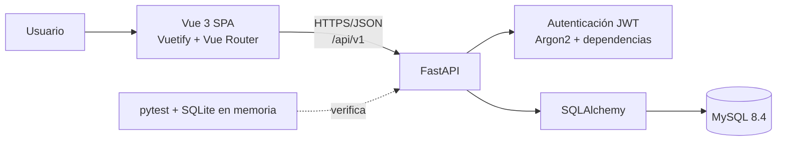
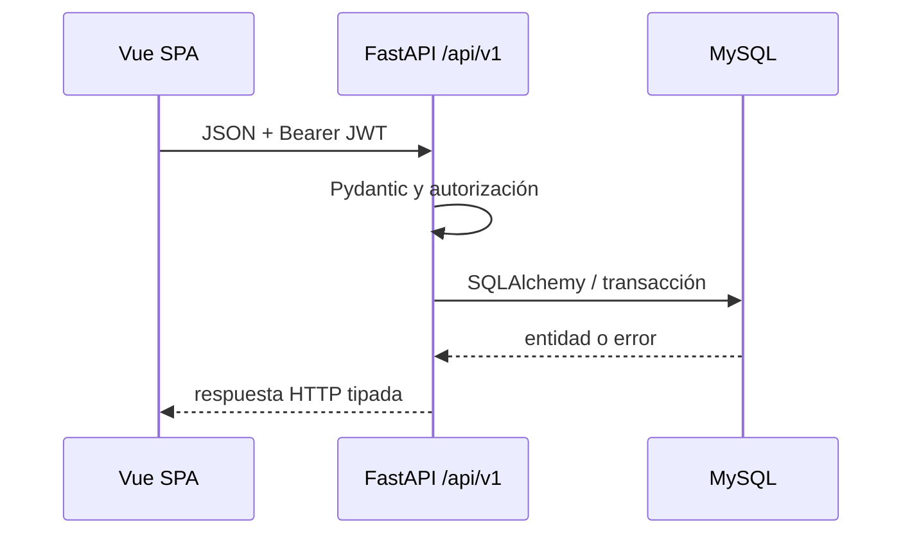
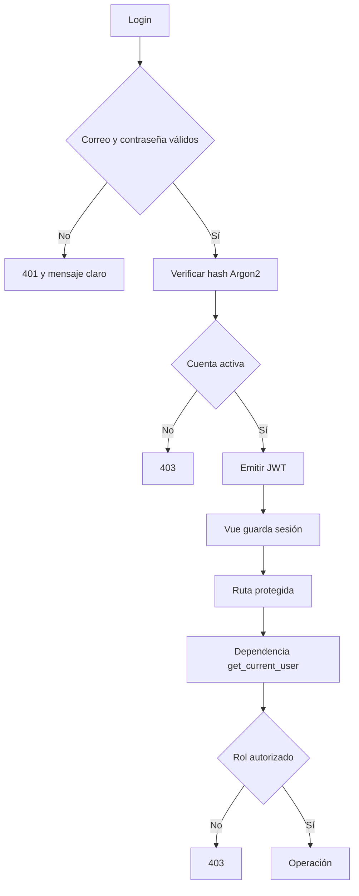
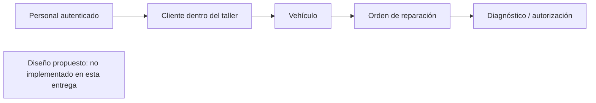
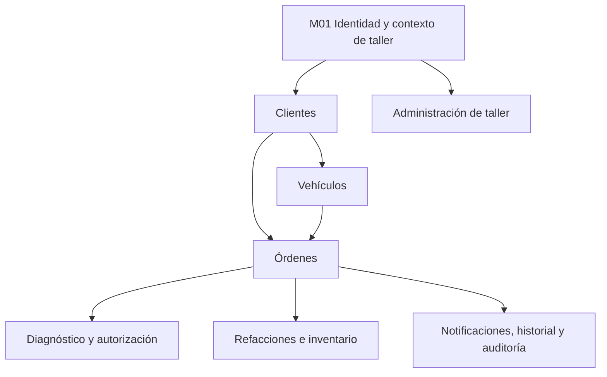

# Arquitectura y diagramas

## Decisión sobre Archify

Se investigó Archify. La herramienta identificada es un skill/renderizador de diagramas para agentes que genera artefactos HTML, no una dependencia necesaria de Vue/FastAPI ni una integración de producción del proyecto. Para no añadir una dependencia no esencial, los diagramas se mantienen como Mermaid en Markdown, revisables en Git y compatibles con GitHub. La evaluación está en [ARCHIFY_EVALUACION.md](ARCHIFY_EVALUACION.md).

## Arquitectura actual

## Comunicación de ejecución

## M01 — autenticación y autorización

## Diseño futuro — clientes y vehículos

## Dependencias entre módulos

