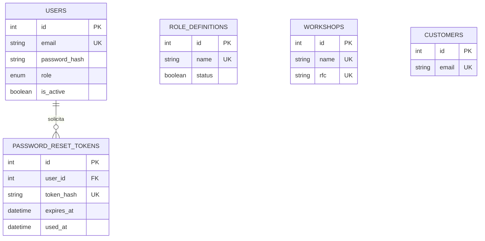
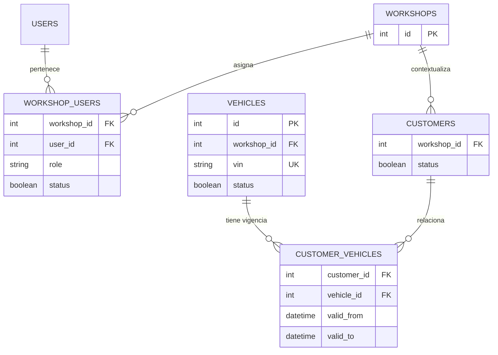

# Modelo de datos

## Entidades existentes

| Entidad | Clave y restricciones | Uso actual |
|---|---|---|
| `users` | PK `id`, `email` único, `role` enum, `is_active` | Identidad y autorización de M01 |
| `customers` | PK `id`, `email` único | Alta/listado básico heredado; aún sin taller, baja lógica ni auditoría |
| `role_definitions` | PK `id`, `name` único, `status` booleano | Catálogo administrable de roles |
| `workshops` | PK `id`, `name` y `rfc` únicos | Alta básica de taller |
| `password_reset_tokens` | PK `id`, hash de token único, FK `user_id` | Recuperación de contraseña |

## Diagrama entidad–relación actual

`role_definitions` no es todavía una FK de `users.role`: el usuario usa un enum técnico. Tampoco existe relación entre `users`, `workshops` y `customers`; por ello el aislamiento por taller no está implementado y no debe declararse terminado.

## Entidades propuestas — fases posteriores

Este segundo diagrama es una propuesta, no una migración ni un esquema aplicado. Cualquier cambio de esquema deberá entrar mediante una nueva migración versionada; no se deben modificar tablas ya aplicadas manualmente.
